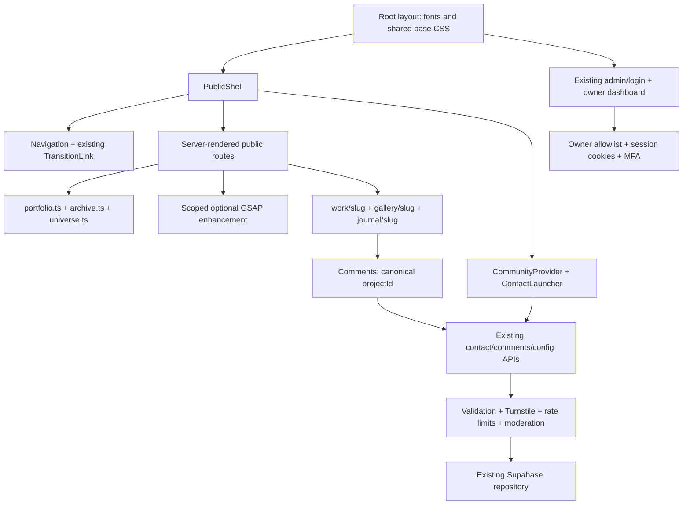

# Public rewrite boundary

Baseline: `606934d`, branch `design/work-gallery-checkpoint-20261018`; clean working tree. New review branch: `design/other-side-of-default-20261018`. Local main (`b49190f`) is three commits behind; no divergent main commits. No reset, merge, deployment, migration or environment-file edit.

Nickname: only `src/data/site.ts`. Personal facts: `portfolio.ts`. Media/writing records: `archive.ts`; public adapters, stable slugs and verified identities: `universe.ts`. Work comments use `commentProjectId`, independent of title or presentation. Collaboration uses `WorkActions` → `OpenMessage` → `portfolio:open-contact`; the textarea stays editable. Contribution links require the existing verified-public flag.

Guestbook reads approved records; pending messages and contact inbox stay private. Admin, auth/MFA, backend libraries, API routes and database policies are outside the visual rewrite. Preview clears Supabase connection/key variables so no production data is read or submitted. Unconfigured forms report unavailability, never success.

The previous home hero, Work/Gallery scenes and generic page timelines are visual implementation only. New scenes use a scoped GSAP matchMedia/context owner and revert on unmount, width changes and reduced-motion changes. No smooth-scroll library or additional ticker. Legacy detail reading and viewer functionality remain available.

## Deferred systems

No CMS implementation. Current editable content remains in typed repository records; the private dashboard provides moderation/inbox, not the requested full authoring system. No anonymous two-way chat. A future design would need an opaque server-verified browser token in a secure HttpOnly cookie, protected owner replies, optional recovery, retention/consent and anti-abuse controls. It must never identify visitors only by IP.

## References

Read the entire combined brief and SOURCE_TECHNIQUES before application edits. Inspected local Strade opening and Beantab scroll captures and their saved HTML inventory. Strade shows a multi-column name/venture composition; that silhouette is deliberately abandoned. Beantab's saved scroll capture is mostly blank, so it supplies no verified timing model. External HTML/assets and downloaded ZIPs remain outside this repository. Existing owner hero/demo remains preserved in its original parent-folder location.
